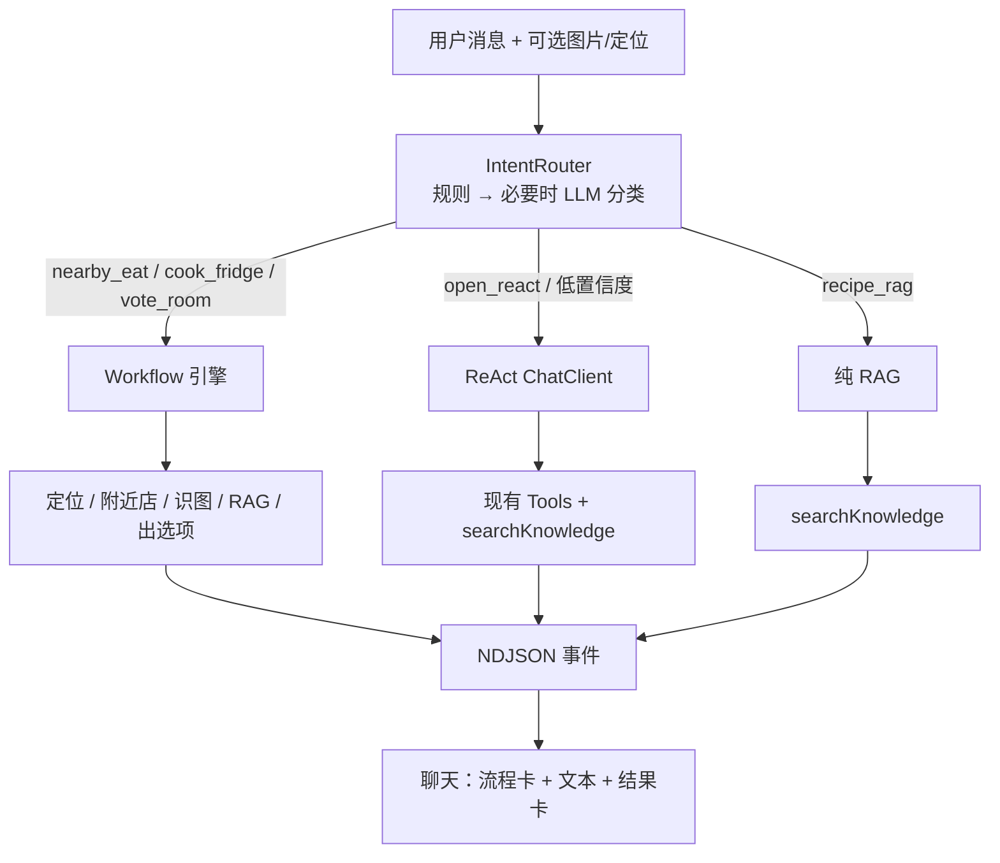

# DecideMeal AI：RAG + 路由 + ReAct + Workflow 计划

> 范围：`soulfood-backed` Agent 层 + Flutter `lib/features/agent`。  
> 前提：PostgreSQL 已安装 pgvector；Spring AI 1.1.x + 智谱 GLM 已接通；聊天已有 Tool Calling 与结果卡。  
> 原则：**规则路由优先，LLM 只做歧义分类；RAG / ReAct / Workflow 分工，不做成三套并行大脑；流程卡与结果卡分离。**  
> 配套文档：[库表字段说明](./db-schema.md) · [RAG 种子目录（FAQ + 常识）](./rag-seed-catalog.md) · [API 对接清单](../API对接清单.md)

---

## 1. 目标

在现有 `/ai/chat` 流式对话上，补齐四层能力：

| 层 | 职责 | 谁拍板 |
|----|------|--------|
| 路由 | 决定走 Workflow / ReAct / 纯 RAG | 规则为主，歧义时小模型分类 |
| RAG | 检索菜谱说明、FAQ、运营规则 | pgvector 相似度 |
| ReAct | 开放问答，按需调工具 | 模型 + Tool Calling |
| Workflow | 固定多步场景，边走边推流程卡 | 代码编排 |

前端聊天里用**流程卡片**展示步骤进度，用**结果卡片**展示餐厅 / 菜谱 / 投票（沿用现有，不强行同一套字段）。

**同期文档需求（P0 一并完成）：**

1. **RAG 初始语料**：写入 FAQ（产品怎么用）+ 饮食常识，见 [rag-seed-catalog.md](./rag-seed-catalog.md)；embedding 启动后批量计算，禁止把向量写进 SQL。
2. **全库表文档**：现有 `sf_*` 表名、字段含义已整理到 [db-schema.md](./db-schema.md)；新增表（含 `sf_rag_chunk`）必须同步改该文档。
3. **接口对接文档**：凡新增/变更 HTTP 接口（含请求体、响应、鉴权、流式事件），必须同步改 [API对接清单.md](../API对接清单.md) 的「AI」及对应章节，并写上 Flutter 调用方。接口合入与文档同一批完成，不另开「回头补文档」。

---

## 2. 现状（已具备，不重做）

- `ChatClient` + `AiChatTools`：附近餐厅、菜谱搜索、建投票房、收藏（弱 ReAct）。
- `MessageChatMemoryAdvisor` + `sf_ai_user_memory`：会话记忆与分层偏好（仍是列表，非向量）。
- 流式协议：`{ type: chunk }` → `{ type: done, cards }`。
- 结果卡：`recipe | restaurant | vote_room`，字段 `type / id / name / subtitle`。

缺的是：知识检索、意图分流、显式多步编排、过程可视化、工具调用治理（限轮次 / 日志）。

---

## 3. 总体架构



路由枚举（第一期固定，禁止自由文本）：

```text
nearby_eat | cook_from_fridge | recipe_rag | vote_room | open_react
```

---

## 4. 路由

**不做「全程 LLM 调度」。** 路由器只输出下一跳，不带 tools、不带长记忆。

### 4.1 第一级：规则（默认）

| 条件 | 意图 |
|------|------|
| 有图 | `cook_from_fridge` |
| 文案含「附近 / 探店 / 外卖」且有 lat/lng | `nearby_eat` |
| 文案含「怎么做 / 步骤 / 食谱」+ 菜名倾向 | `recipe_rag` |
| 文案含「投票 / 组局 / 一起吃」 | `vote_room` |
| 其余 | 进入 4.2 或直接 `open_react` |

### 4.2 第二级：LLM 分类（仅歧义）

- 输入：用户文本、是否有图、是否有定位。
- 输出：`{ "intent": "...", "confidence": 0~1 }`，温度尽量低。
- `confidence < 0.6` → 强制 `open_react`。
- 模型可与对话共用智谱，但走 **stateless、无 tools** 的短 prompt。

---

## 5. RAG（pgvector）

第一期知识来源三块：**菜谱库切块**、**产品 FAQ**、**饮食常识**。用户记忆仍走 `sf_ai_user_memory`，不向量化。

表级字段总览见 [db-schema.md](./db-schema.md)；种子正文见 [rag-seed-catalog.md](./rag-seed-catalog.md)。

### 5.1 表（Flyway，schema `food`）

```sql
CREATE EXTENSION IF NOT EXISTS vector;

CREATE TABLE sf_rag_chunk (
    id          BIGSERIAL PRIMARY KEY,
    source_type VARCHAR(32) NOT NULL,   -- recipe | faq | common
    source_id   BIGINT,
    source_key  VARCHAR(64),            -- 种子稳定键，菜谱切块可空
    title       VARCHAR(128),
    content     TEXT NOT NULL,
    embedding   vector(1024) NOT NULL,  -- 与 embedding 模型维度锁定
    created_at  TIMESTAMPTZ NOT NULL DEFAULT now(),
    UNIQUE (source_key)
);

CREATE INDEX idx_sf_rag_chunk_hnsw
    ON sf_rag_chunk USING hnsw (embedding vector_cosine_ops);
CREATE INDEX idx_sf_rag_chunk_type ON sf_rag_chunk (source_type);
```

换 embedding 模型必须全量重算，禁止混写不同维度。`source_key` 仅 FAQ/常识种子使用，便于覆盖更新。

### 5.2 初始数据（必须随 P0 入库）

| 来源 | source_type | 数量（第一批） | 怎么进库 |
|------|-------------|----------------|----------|
| [rag-seed-catalog.md](./rag-seed-catalog.md) A 节 | `faq` | 17 | 应用启动或一次性命令读取文案 → embedding → upsert |
| 同文档 B 节 | `common` | 25 | 同上 |
| `sf_recipe` 现有行 | `recipe` | 与菜谱条数相同 | 拼 `name/summary/ingredients/steps` 后切块 |

**不能**用 Flyway 插入 `embedding` 列（向量依赖模型，SQL 里写死会错维度）。Flyway 只建表；语料以 markdown/JSON 为源，ingest 任务负责向量。

验收问句示例（应能召回到对应种子）：

- 「怎么加入房间 / 房间号在哪」→ FAQ 组局
- 「附近没定位能推荐店吗」→ FAQ 附近觅食
- 「隔夜米饭能吃吗」「土豆丝发黑」→ 常识
- 「红烧肉怎么做」→ 菜谱切块（`sf_recipe`）

### 5.3 服务

- `EmbeddingClient`：智谱 embedding（如 `embedding-3`），与 chat 的 `base-url` 共用，路径单独配。
- `RagIngestService`：种子 upsert + 菜谱切块（300～500 字）。
- `RagSearchService`：`hybrid` 为默认——pg_trgm 关键词与 `embedding <=>` 各取一池，RRF 融合；可切 `lexical` / `embedding`。不走 Spring AI `VectorStore`。
- 暴露为 Tool：`searchKnowledge(query)`，ReAct 与 Workflow 节点共用。
- MyBatis 写向量用 `PGobject` / `'[0.1,0.2,...]'`，不引入 LangChain。

纯 `recipe_rag`：检索结果直接拼进短 system，一次生成，不走工具循环。FAQ/常识与菜谱可同一次检索，prompt 里标明来源类型以免把常识当成某道菜的步骤。

---

## 6. ReAct（在现有 Tool Calling 上收口）

不自己解析 `Thought/Action` 文本。继续用 Spring AI Function Calling。

补齐：

- `maxToolCalls`（建议 4～6），超时与失败 Observation 回传模型。
- 工具白名单：开放问答用全量；Workflow 节点内只挂该步需要的 tool。
- 结构化日志：conversationId、toolName、耗时、是否成功。
- RAG 只作为 `searchKnowledge`，禁止每轮把知识库全文塞进 system prompt。

---

## 7. Workflow

第一期用**代码编排**（Java 方法链 + 事件回调），不上 LangGraph。出现「暂停等人确认 / 分支回滚 / 可视化图编辑」再评估 Graph。

| id | 场景 | 节点 |
|----|------|------|
| `nearby_eat` | 今晚吃什么 | locate → nearby_search → preference_filter → present_options |
| `cook_from_fridge` | 冰箱 / 菜单图 / 看图做菜 / 按食材做菜 | vision → rag_recipes → present_options |
| `vote_room` | 组局 | collect_options → create_room |

每个节点结束 `emit(step)`；需要人确认时 `status=waiting`，前端按钮回调带 `workflowRunId + stepId` 续跑。

---

## 8. 前端协议：流程卡 ≠ 结果卡

结果卡保持现有 `ChatActionCard`。流程用**新事件**，历史回放写入助手消息 `meta_json`。

### 8.1 流式事件（在现有 NDJSON 上扩展）

```json
{ "type": "workflow", "runId": "w_xxx", "title": "今晚吃什么", "status": "running" }
{ "type": "step", "runId": "w_xxx", "id": "nearby_search", "title": "搜附近餐厅", "status": "running" }
{ "type": "step", "runId": "w_xxx", "id": "nearby_search", "status": "done", "summary": "找到 8 家" }
{ "type": "chunk", "text": "结合你的口味，这几家比较合适：" }
{ "type": "cards", "items": [ { "type": "restaurant", "id": 1, "name": "…", "subtitle": "1.2km" } ] }
{ "type": "done", "conversationId": "…", "cards": [ /* 结果卡汇总，兼容旧客户端 */ ] }
```

`step.status`：`pending | running | done | failed | waiting`。

### 8.2 UI

一条助手气泡内三层，不必和结果卡长得一样：

1. **流程总卡**：场景名 + 总状态。
2. **步骤条**：标题 + 短摘要 + 状态点。
3. **结果卡区**：复用现有 `_CardBlock`。

打开历史会话时，用 `meta_json` 里的 workflow 快照还原步骤条（终态），不必重跑。

### 8.3 对接清单要写什么

在 [API对接清单.md](../API对接清单.md)「AI」节至少补全：

| 变更 | 文档里写清 |
|------|------------|
| 现有 `POST /ai/chat`、流式接口 | 新字段（定位、图片）；NDJSON 事件：`workflow` / `step` / `chunk` / `cards` / `done` |
| 若新增 `POST /ai/workflow/{runId}/continue` | 续跑 body：`stepId`、用户确认项；鉴权 |
| 若新增 ingest / 检索调试接口（仅开发） | 标明非 App 主路径，避免前端误接 |
| 旧客户端 | `chunk` + `done.cards` 仍可用；不认识的 `type` 忽略 |

---

## 9. 目录建议

**后端**（`com.food.soulfoodbackend`）

```text
ai/
  router/     IntentRouter, RuleIntentRouter, LlmIntentRouter
  rag/        EmbeddingClient, RagIngestService, RagSearchService
  react/      ToolCallGuard（限轮次 / 日志）
  workflow/   WorkflowRegistry, NearbyEatWorkflow, FridgeWorkflow
  stream/     ChatStreamEmitter（统一写 NDJSON）
```

现有 `AiChatService` 只负责接入口：路由 → 分发 → 流式写出。Tools 仍放现在的 `@Tool` 类，RAG 增一个即可。

**前端** `lib/features/agent/`

- `chat_stream_event.dart`：解析 `workflow / step / chunk / cards / done`
- `workflow_card.dart`：流程总卡 + 步骤条
- `ai_chat_page.dart`：流式过程中增量更新步骤，结束再挂结果卡

---

## 10. 分阶段

### P0 — 协议与 RAG 底座（先可检索，再可视化）

1. Flyway：`vector` 扩展 + `sf_rag_chunk`（含 `source_key` / `faq|common|recipe`）。
2. 实现 `EmbeddingClient` + `RagIngestService`。
3. **灌入初始知识**：[rag-seed-catalog.md](./rag-seed-catalog.md) 的 FAQ + 常识，并切块现有 `sf_recipe`。
4. `searchKnowledge` Tool；`recipe_rag` 直出。
5. 保持 [db-schema.md](./db-schema.md) 与真实表一致（本计划已完成首版表文档）。
6. NDJSON 增加 `workflow` / `step` / `cards`（可先只打日志，前端后接）。
7. 流式事件协议写入 [API对接清单.md](../API对接清单.md)。

### P1 — 路由 + 一条 Workflow + 流程卡

1. `IntentRouter` 规则 + 低置信 LLM。
2. 落地 `nearby_eat`，节点推 `step`。
3. Flutter 流程卡 + 兼容旧 `done.cards`。
4. 更新对接清单：chat 流式事件 + 前端页面。

### P2 — ReAct 治理 + 其余 Workflow

1. `maxToolCalls`、工具日志。
2. `cook_from_fridge`、`vote_room`。
3. `waiting` 步骤 + 续跑 API。
4. 续跑接口同步进对接清单。

### P3 — 按需

用户记忆向量化、Graph 引擎、LLM 循环选下一跳。**默认不做。** 混合检索（pg_trgm + 向量 RRF）已做。

离线路由 / RAG 关键词 / waiting 文案黄金集已落地：`soulfood-backed/src/test/resources/ai-eval/golden-eval.json`，由 `GoldenEvalTest` 跑，不打 LLM、不连库。不在生产消息里记 intent/tools 来代替评测。

---

## 11. 依赖与配置

- 已有：PostgreSQL + pgvector、Flyway、Spring AI OpenAI starter、智谱 chat。
- 新增：embedding 模型与维度配置（`app.ai.embedding-model` / `app.ai.embedding-dims`）。
- 不新增：LangChain、独立向量库、Graph 框架（P3 再议）。

---

## 12. 风险

| 级别 | 风险 | 应对 |
|------|------|------|
| 高 | embedding 维度与列不一致 | 配置与 DDL 同一常量，启动校验 |
| 高 | 智谱 embedding 路径/鉴权与 chat 不同 | 单独测通再接对话 |
| 中 | 每轮都 RAG / 工具过多导致变慢 | 路由分流；ReAct 限轮次；Workflow 按节点检索 |
| 中 | 旧客户端只认 `chunk/done` | 新事件可忽略；`done.cards` 保持兼容 |
| 中 | GLM Tool Calling 不稳定 | Workflow 关键步用代码调 Service，不交给模型 |
| 低 | 模拟器 / 本地 HTTP | 与本次 AI 计划无关，联调用 `127.0.0.1` 或 dart-define |

---

## 13. 验收（P1 完成即算打通）

- 问「红烧肉怎么做」：走 RAG，回答含库内步骤，不编造库存外硬菜细节。
- 问「怎么加入房间」「隔夜米饭能不能吃」：分别命中 FAQ / 常识种子，而不是空检索后瞎编产品功能。
- 问「附近吃什么」且有定位：出现流程卡（定位 → 搜索 → 出店），下方为现有餐厅结果卡。
- 闲聊 / 低置信：走 ReAct，仍可调现有 tools，不误进 Workflow。
- 旧历史消息：无流程快照时只显示文本 + 旧结果卡，不报错。
- [db-schema.md](./db-schema.md) 覆盖当前全部 `sf_*` 表及主要字段。
- 新增/变更的 AI 接口已写入 [API对接清单.md](../API对接清单.md)，含路径、方法、鉴权、请求/响应或事件类型、Flutter 调用方。

---

## 14. 明确不做（第一期）

- 用 LLM 当全局调度器循环选下一跳。
- 流程卡与结果卡共用同一 DTO。
- 上 LangGraph / 可视化流程编辑器。
- 全量对话、订单、收藏都写入向量。
